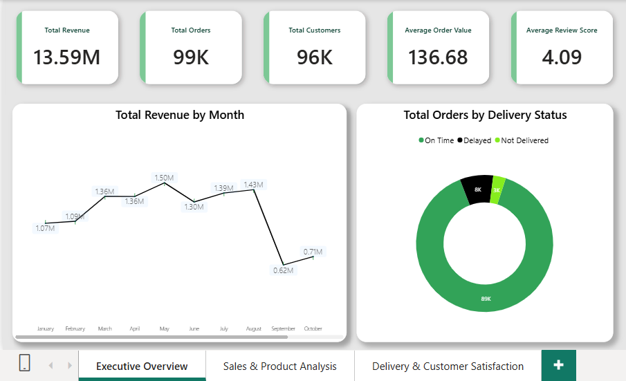
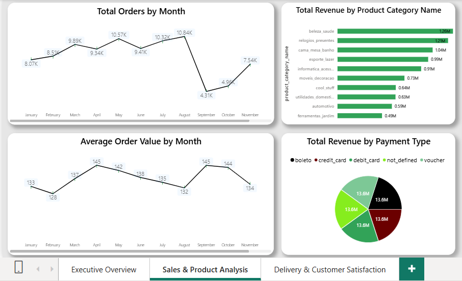
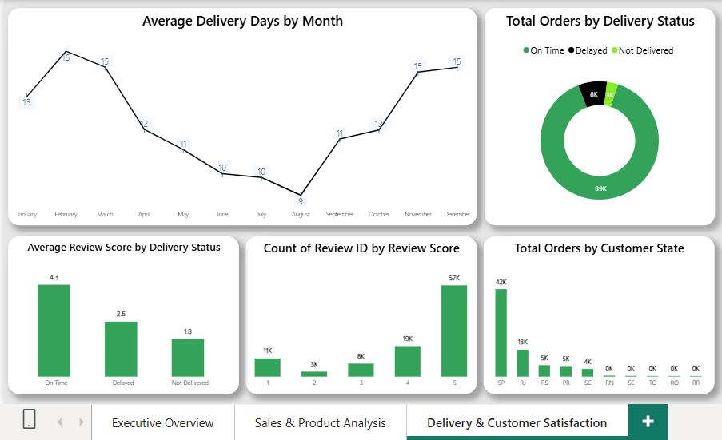

# Olist E-commerce Sales & Customer Satisfaction Analysis

## Project Overview
This project analyzes the Brazilian E-commerce Public Dataset by Olist to understand sales performance, delivery efficiency, and customer satisfaction.  
The goal is to identify key business insights and provide actionable recommendations to improve operations and customer experience.

**Tools Used:** Power BI, Power Query, DAX

---

## Business Problem
Olist wants to understand:
- Which product categories and regions are driving the most revenue?
- How is the delivery performance affecting customer satisfaction?
- What actions can be taken to improve on-time delivery and review scores?

---

## Dataset
- **Source:** [Brazilian E-Commerce Public Dataset by Olist](https://www.kaggle.com/datasets/olistbr/brazilian-ecommerce)
- **Period:** 2016 – 2018
- **Tables Used:** Orders, Order Items, Customers, Payments, Reviews, Products

---

## Dashboard Screenshots

### 1. Executive Overview

### 2. Sales & Product Analysis

### 3. Delivery & Customer Satisfaction

---

## Key Insights

### Sales Performance
- Total Revenue: **R$ 13.59 Million**
- Top performing category: **Beleza & Saúde (Beauty & Health)**
- Highest number of orders from **São Paulo (SP)** state

### Delivery Performance
- On-Time Delivery Rate: **89.15%**
- Delayed Orders: **7.87%**
- Not Delivered Orders: **2.98%**
- Average Delivery Days range between **9 to 16 days**

### Customer Satisfaction
- Average Review Score (On-Time): **4.3**
- Average Review Score (Delayed): **2.6**
- Average Review Score (Not Delivered): **1.8**
- Delayed deliveries cause a **1.7 point drop** in customer ratings

---

## Recommendations

1. **Improve Delivery Performance**  
   Delayed orders significantly hurt customer satisfaction (review score drops from 4.3 to 2.6). Focus on improving logistics SLAs to increase On-Time Delivery above 95%.

2. **Strengthen Top Category**  
   Beleza & Saúde is the highest revenue-generating category. Increase marketing spend, inventory availability, and seller quality in this segment.

3. **Reduce Not Delivered Orders**  
   Nearly 3% of orders are not delivered. Investigate root causes (address issues, seller problems, logistics failures) and fix them.

4. **Focus on São Paulo Market**  
   SP contributes the highest number of orders. Run targeted campaigns and offer faster delivery options in this region.

---

## How to View the Dashboard
- Download the Power BI file from [Google Drive Link: https://drive.google.com/file/d/1s9ExAT2qU6yJwMkrC87EZudhSprtPgtZ/view?usp=sharing ]
- Open it in Power BI Desktop

---

## Author
## Bharati Patil
Aspiring Data Analyst | Power BI | Data Analysis
